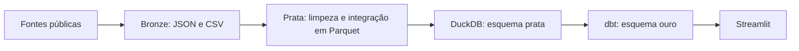

# Projeto Cyber

Projeto acadêmico de **Engenharia de Dados na Prática** (ECOX14/UNIFEI), ministrada pela professora Bárbara Pimenta Caetano. Integra três fontes públicas de vulnerabilidades de segurança da informação em uma arquitetura medalhão (aulas 1 a 11).

## Objetivo

**Pergunta norteadora:** O EPSS oferece informações complementares ao CVSS na priorização de vulnerabilidades, considerando os casos de exploração conhecida registrados no catálogo CISA KEV?

A pergunta foi refinada após a exploração dos dados. O estudo é descritivo, não preditivo.

## Fontes de dados

| Fonte | Finalidade | Formato na Bronze | Chave |
|---|---|---|---|
| [NVD — National Vulnerability Database](https://nvd.nist.gov/vuln/data-feeds) (principal) | Informações das vulnerabilidades e severidade técnica CVSS (0 a 10) | JSON | `id` |
| [EPSS — Exploit Prediction Scoring System](https://www.first.org/epss/) | Probabilidade estimada de exploração nos próximos 30 dias e percentil | CSV | `cve` |
| [CISA KEV — Known Exploited Vulnerabilities Catalog](https://www.cisa.gov/known-exploited-vulnerabilities-catalog) | Vulnerabilidades com evidências de exploração conhecida | CSV | `cveID` |

A NVD utiliza os feeds de [2024](https://nvd.nist.gov/feeds/json/cve/2.0/nvdcve-2.0-2024.json.gz), [2025](https://nvd.nist.gov/feeds/json/cve/2.0/nvdcve-2.0-2025.json.gz) e [2026](https://nvd.nist.gov/feeds/json/cve/2.0/nvdcve-2.0-2026.json.gz) (ano do identificador CVE, não necessariamente de publicação). Downloads das fontes secundárias: [EPSS](https://epss.cyentia.com/epss_scores-current.csv.gz) e [KEV](https://www.cisa.gov/sites/default/files/csv/known_exploited_vulnerabilities.csv).

## Arquitetura



- `dados/bronze/`: ingestão HTTP, arquivos datados sem limpeza e proveniência.
- `dados/prata/`: limpeza, atributos derivados e integração em quatro arquivos Parquet.
- `dados/ouro/`: banco DuckDB com esquema `prata` (carga) e `ouro` (modelos dbt).
- `dashboard/`: Streamlit, somente leitura, com indicadores, gráficos, filtros e tabela.

Ferramentas: Python, pandas, requests, fg-data-profiling, PyArrow, DuckDB, dbt e Streamlit. Configuração em `src/config.py`; orquestração em `src/pipeline.py`.

## Tratamento e integração

O profiling (`src/explorar.py`) gera cinco HTMLs em `relatorios/`. A exploração dos arquivos de 15/10/2026 revelou chaves únicas, CVSS ausente, referências assimétricas, EPSS sem nulos e ausências em `cwes` do KEV.

- **NVD:** concatena os três anos, remove `Rejected`, converte datas para UTC e valida CVSS em [0, 10], preservando ausentes. A política local prefere métricas v4.0, v3.1, v3.0 e v2, nessa ordem; depois `Primary` e fonte NVD, com desempate determinístico. Preserva os metadados da métrica escolhida.
- **EPSS:** converte probabilidade e percentil para número; remove falhas de conversão de valores preenchidos e valores fora de [0, 1]. Mantém extremos válidos.
- **CISA KEV:** converte datas, verifica a ordem entre inclusão e prazo de remediação e preserva `Unknown` em ransomware.

As três transformações removem espaços nas bordas dos textos e nomes das colunas, conferem chaves e, se houver duplicatas, mantêm a primeira ocorrência com registro da remoção.

### Atributos derivados

| Atributo na Prata | Significado |
|---|---|
| `sem_pontuacao_cvss` | Sinaliza a ausência de pontuação CVSS, sem imputar valores. |
| `vetor_ataque_rede` | Identifica `AV:N` no vetor CVSS; nulo quando não há vetor. |
| `num_referencias_extremo` | Sinaliza extremos pelo critério de 1,5 × IQR, sem removê-los. O IQR foi preferido ao z-score pela distribuição assimétrica das referências. |
| `cvss_selecao_ambigua` | Indica mais de uma métrica candidata após as preferências da política local. |
| `tem_epss` e `consta_kev` | Indicam correspondência com as fontes secundárias. |
| `cvss_alto_epss_top10` | Combina severidade `HIGH` ou `CRITICAL` com percentil EPSS ≥ 0,90; nulo se faltar severidade ou percentil. Permite avaliar a seleção conjunta. |

`src/enriquecer.py` confere as chaves e integra EPSS e KEV à NVD por duas junções `left`, com `validate="one_to_one"`. Preserva quantidade e unicidade da NVD, sem preencher EPSS ausente com zero.

## Modelagem e qualidade da Ouro

Banco: `dados/ouro/projeto.duckdb`. Grão da dimensão, fato e view: **uma linha por CVE da NVD no recorte**, sem histórico por vulnerabilidade.

| Modelo | Conteúdo |
|---|---|
| `ouro.dim_cve` | Atributos descritivos, severidade e metadados CVSS. |
| `ouro.fato_risco_cve` | Pontuação CVSS, EPSS, presença no KEV e demais indicadores. |
| `ouro.vw_vulnerabilidades_completas` | View que relaciona dimensão e fato pela chave `cve_id` (1:1). |

A carga é transacional. O dbt usa `source()` e `ref()` e executa seis testes: `unique` e `not_null` nas duas chaves, `relationships` e consistência da flag combinada. O Python confere também chaves vazias, órfãos e preservação das contagens e indicadores. Falhas interrompem o pipeline, com registro no terminal e no `pipeline.log`.

## Execução

Execução validada no Windows com Python 3.13.5. Clone o repositório e, na raiz, crie o ambiente virtual e instale as dependências:

```cmd
python -m venv .venv
.venv\Scripts\activate.bat
python -m pip install -r requirements.txt
```

No PowerShell, a ativação é `.venv\Scripts\Activate.ps1`; no Linux/macOS, `source .venv/bin/activate`.

### Pipeline

```bash
python src/pipeline.py
```

Requer internet para a ingestão. A ordem é: ingestão → transformação → enriquecimento → carga → modelagem (`dbt run`, `dbt test` e validação da Ouro). Para retomar uma etapa, informe `ingestao`, `transformacao`, `enriquecimento`, `carga` ou `modelagem`, desde que as saídas anteriores existam. Exemplo:

```bash
python src/pipeline.py modelagem
```

O profiling é opcional na execução do pipeline e roda separadamente após a ingestão:

```bash
python src/explorar.py
```

### Dashboard

```bash
python -m streamlit run dashboard/painel.py
```

Acesse <http://localhost:8501>. O painel utiliza consultas parametrizadas em `dashboard/consultas.py`, sem modificar o banco. Feche o painel antes de reprocessar os dados para evitar conflitos de acesso ao DuckDB.

### Testes e documentação dbt

Na raiz, com o ambiente virtual ativo e a Ouro já construída:

```bash
cd ecox14
dbt test --project-dir . --profiles-dir .
dbt docs generate --project-dir . --profiles-dir .
dbt docs serve --project-dir . --profiles-dir .
```

A documentação fica disponível em <http://localhost:8080>. Execute esses comandos dentro de `ecox14/`, pois o perfil usa o caminho relativo `../dados/ouro/projeto.duckdb`. Encerre o servidor com `Ctrl+C` e retorne à raiz com `cd ..`.

## Resultados — coleta de 19/11/2026

Execução validada: três modelos e seis testes dbt aprovados, documentação e filtros do painel conferidos.

| Saída da Prata | Antes | Depois |
|---|---:|---:|
| NVD | 178.682 | 174.636 |
| EPSS | 409.087 | 409.087 |
| CISA KEV | 1.786 | 1.786 |
| Vulnerabilidades enriquecidas | 174.636 | 174.636 |

Foram removidos 4.046 `Rejected`, mantidas 3.382 CVEs sem CVSS e sinalizados 6.175 extremos de referências. Todas as CVEs da NVD tratada encontraram EPSS; 568 constavam no KEV e 174.068 não constavam. Outros 234.451 registros EPSS e 1.218 KEV estavam fora do universo NVD tratado; as fontes secundárias têm cobertura própria e não ampliam o recorte principal.

### Resposta à pergunta norteadora

A análise descritiva das 171.254 CVEs com CVSS e EPSS disponíveis (incluindo as 568 do KEV) produziu os seguintes resultados:

| Critério | CVEs selecionadas | No KEV | Cobertura dos 568 casos KEV |
|---|---:|---:|---:|
| CVSS alto ou crítico | 84.680 | 501 | 88,20% |
| Percentil EPSS ≥ 0,90 | 3.329 | 436 | 76,76% |
| CVSS alto/crítico e percentil EPSS ≥ 0,90 | 2.575 | 396 | 69,72% |
| CVSS alto/crítico ou percentil EPSS ≥ 0,90 | 85.434 | 541 | 95,25% |

**Sim.** Das 67 vulnerabilidades presentes no KEV com severidade baixa ou média, 40 (59,7%) têm percentil EPSS ≥ 0,90. O EPSS, portanto, destaca casos conhecidos que não seriam selecionados pelo critério exclusivo de severidade alta ou crítica.

Com o mesmo limite de 2.575 CVEs, os rankings CVSS e EPSS selecionaram, respectivamente, 64 e 407 casos do KEV (desempate por identificador CVE; máximo possível do CVSS com outros desempates: 178). A regra combinada selecionou 396. Logo, complementaridade não garante que a combinação seja superior.

Os resultados centrais podem ser conferidos no banco DuckDB com a consulta:

```sql
SELECT severidade_cvss,
       COUNT(*) AS no_kev,
       COUNT(*) FILTER (WHERE percentil_epss >= 0.90) AS epss_elevado
FROM ouro.vw_vulnerabilidades_completas
WHERE consta_kev IS TRUE
GROUP BY severidade_cvss;
```

## Limitações e proveniência

A coleta contemporânea não demonstra previsão futura. Ausência no KEV não prova ausência de exploração; `dateAdded` é inclusão no catálogo, não primeiro ataque. O percentil EPSS ≥ 0,90 é um limiar exploratório relativo à distribuição global do EPSS, não 90% de probabilidade nem exatamente 10% do recorte. As versões CVSS diferem, e a priorização real depende do contexto dos ativos.

A proveniência da [Bronze](dados/bronze/) e [Prata](dados/prata/proveniencia.jsonl) é versionada em JSONL: origem, horários UTC, contagens e decisões, conforme a etapa. Dados, relatórios e logs ficam fora do Git. Novas coletas podem mudar os resultados; uma repetição no mesmo dia pode substituir arquivos. A transformação seleciona os arquivos mais recentes por fonte e substitui os Parquet. Preserve a Bronze correspondente e alinhe as datas para reproduzir os resultados históricos.
